<!-- Animated cards are self-contained SVGs in ./assets (CSS/SMIL animation, embedded subset fonts). -->
<p align="center">
  
</p>

<p align="center">
  <a href="https://arxiv.org/abs/2603.24124"></a>
  <a href="mailto:liumingyi1993@163.com"></a>
  <a href="https://github.com/DigitLion?tab=followers"></a>
  
</p>


### ⚡ About Me


I'm an **AI Agent Engineer** and **independent researcher** working at the intersection of embodied intelligence, multi-agent systems, and LLM alignment. My research explores how alignment methods reshape model behavior — and what that means for real-world uncertainty estimation.


### 🔬 Latest Research

<a href="https://arxiv.org/abs/2603.24124">
  
</a>

<p align="center">
  <a href="https://arxiv.org/abs/2603.24124"></a>
  <a href="https://github.com/DigitLion/ucbd-experiment"></a>
</p>

<details>
<summary><b>📚 Cite this work (BibTeX)</b></summary>

```bibtex
@article{liu2026alignmenttax,
  title={The Alignment Tax: Response Homogenization in Aligned LLMs
         and Its Implications for Uncertainty Estimation},
  author={Liu, Mingyi},
  journal={arXiv preprint arXiv:2603.24124},
  year={2026}
}
```

</details>


### 🛠️ Tech Stack




### 💻 Featured Projects

<p align="center">
  <a href="https://github.com/DigitLion/ucbd-experiment"></a>
  <a href="https://github.com/DigitLion/Fast-Drone-250-450"></a>
</p>


### 📊 GitHub Analytics

<p align="center">
  
  
</p>

<p align="center">
  
</p>

<picture>
  <source media="(prefers-color-scheme: dark)" srcset="https://raw.githubusercontent.com/DigitLion/DigitLion/output/github-snake-dark.svg" />
  <source media="(prefers-color-scheme: light)" srcset="https://raw.githubusercontent.com/DigitLion/DigitLion/output/github-snake.svg" />
  
</picture>


### 🚀 Journey



<p align="center"><i>"The only way to do great work is to love what you do." — Steve Jobs</i></p>


